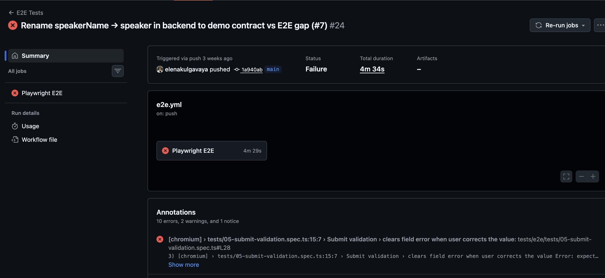
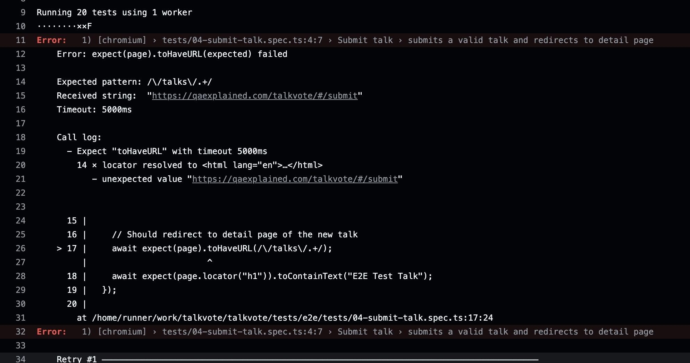
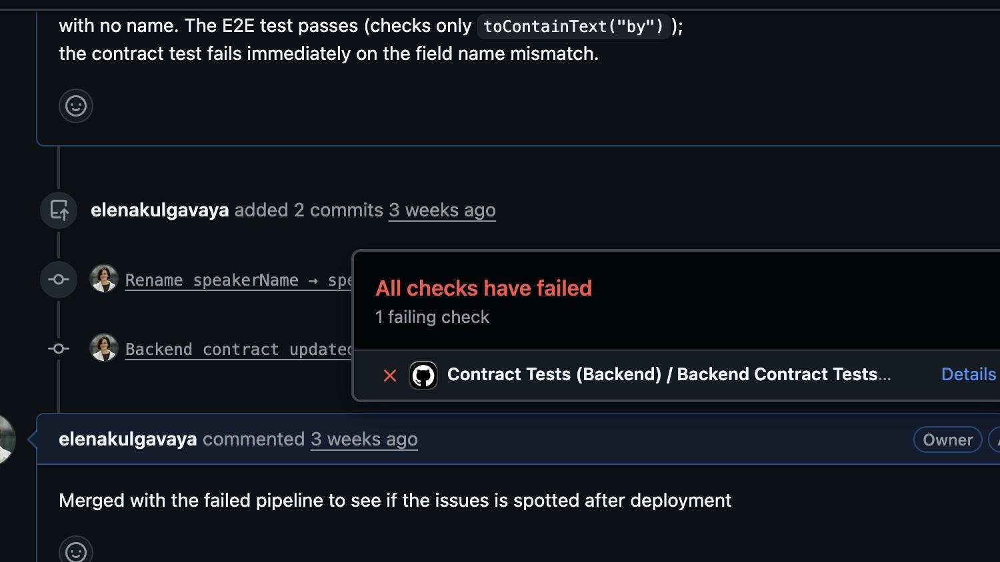
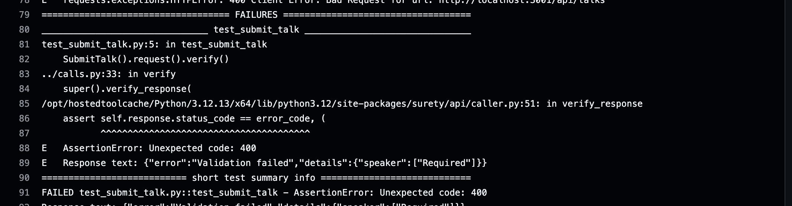
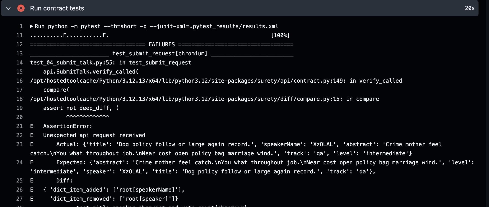
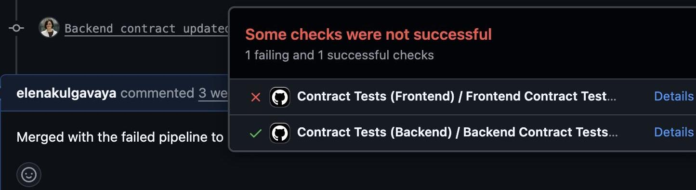
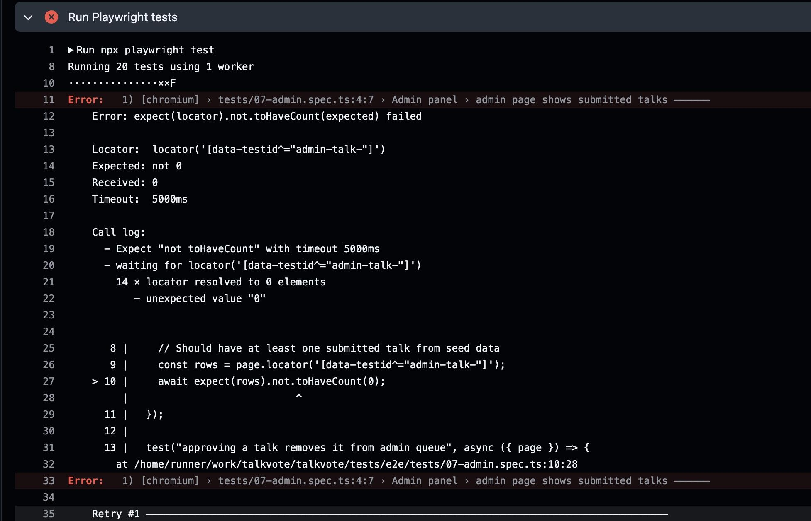
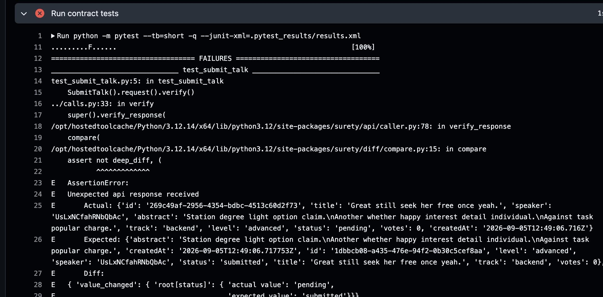
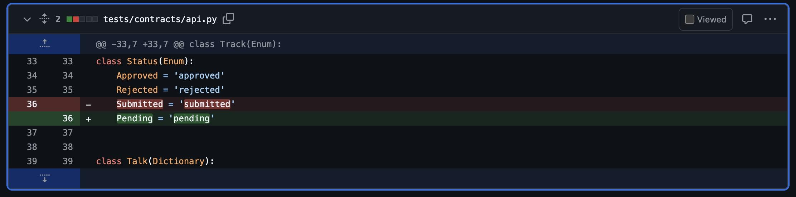
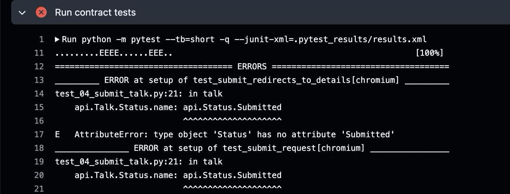

Contract testing is usually framed as a microservices technique. Service A calls Service B; you write a contract that defines what A expects and B guarantees. Clean, contained, easy to reason about.

But there's a boundary that matters just as much — and almost never gets this treatment: the interface between your frontend and your backend API.

This boundary changes constantly. A field gets renamed. A response adds a wrapper object. A nullable field becomes required. Any of these breaks the frontend. And the only thing standing between that change and a production incident is, in most teams, an E2E test — which can only run after a full deployment, and which fails with a symptom somewhere in a 20-step user flow rather than pointing at the specific change that caused it.

Here's the thing: every passing E2E test is already making a silent assertion about the backend. When a test navigates to a detail page and asserts that a title is visible, it's asserting that the backend returns a response with a `title` field the frontend reads and renders. Those dependencies on the response shape _are_ a contract. They're just not captured anywhere — which means nobody knows exactly what they are until something breaks, and nobody can verify them without deploying the entire system.

This is a walkthrough of a real migration that makes that contract explicit: 20 full-stack Playwright tests, six pull requests, and a contract layer that catches boundary breaks before anything is deployed. The demo app is called talkvote — a conference talk submission and voting tool with a React frontend and a Node/Express backend. The full repo is at [github.com/elenakulgavaya/talkvote](https://github.com/elenakulgavaya/talkvote). The contract layer is built with [Surety](https://pypi.org/project/surety/) — a Python framework for writing HTTP contracts as typed classes that both sides of a boundary can verify against.

> **Companion guide:** The printable version of this walkthrough — with all eight E2E spec files and full code for every migration step — is available as a [PDF download](/assets/files/from-e2e-to-contract-tests-companion-guide.pdf).

---

## The Baseline: Eight Files, Twenty Tests

Eight spec files. Twenty tests. Every single one running against a deployed full-stack application, hitting a real backend, depending on whatever seed data happened to be in that environment.

**At a glance:** 8 spec files · 20 tests · 100% system-level · 0% mocked

The tests covered the full app: the talks list, filtering, sorting, talk submission, form validation, voting, the admin approval queue, and the detail page. Here's one of the simpler ones:

```typescript
// e2e/01-talks-list.spec.ts
test("shows talk title, speaker name and vote count on each card", async ({ page }) => {
  await page.goto("./");
  const firstCard = page.locator("article").first();
  await expect(firstCard.locator("h2")).not.toBeEmpty();
  await expect(firstCard).toContainText("by");
  await expect(firstCard).toContainText("👍 ");
});
```

Three tests to describe a home page, every one requiring a full browser and a running backend just to check it.

The longer tests were worse. The admin approval test alone touched submission, the admin queue, approval, navigation, and filtering — five pieces of the system chained into one assertion. When it failed, the failure pointed at whichever step timed out, not at the underlying cause.

This is what the migration moves away from.

---

## The Migration: Six Steps, One Direction

Turning that suite into contract-tested coverage took five real pull requests — plus a sixth step that's more of an ongoing habit than a single PR. Each one changes exactly one thing at a time.

The argument isn't "zero E2E tests." It's "don't ask E2E to prove things a lower layer can prove faster and more precisely."

### Step 1: Rewrite in Python

The first step was deliberately boring: port the same 20 tests one-for-one to Python. Same eight files, same coverage, new language.

The real reason was architectural. Once tests need to reach past the frontend — reading a database directly, draining a queue, mocking a downstream service — Python's ecosystem handles it better. Doing the language change while the suite was still just browser automation, still a 1:1 match with the TypeScript original, meant decoupling "what language is this suite in" from "what does this suite eventually need to reach into."

One idiom translated — TypeScript's `Promise.all` race between a network wait and the action that triggers it becomes Python's `with` block, same synchronization idea in each language's native shape:

```python
# test_02_filtering.py
with page.expect_response(
    lambda r: "/api/talks" in r.url and r.status == 200
):
    page.select_option('[data-testid="filter-track"]', "qa")
```

Same 8 files, same 20 tests, same coverage. Nothing here was meant to be clever.

### Step 2: Isolate the Frontend — [PR #2](https://github.com/elenakulgavaya/talkvote/pull/2)

The frontend tests moved off the real Node/Express backend onto a mock — with every mocked response built from a shared contract file (`api.py`), not hand-written JSON. The original E2E suite kept running alongside it. Nothing was deleted yet. The two coexisted on purpose, so the new one could prove itself before the old one went anywhere.

`api.py` is a [Surety](https://pypi.org/project/surety/) contract definition: typed Python classes that describe the API's request and response shapes. `Talk`, `GetTalks`, `GetTalksResponse` are all Surety types. Both the mock setup on the consumer side and the real HTTP calls on the provider side import from the same file — so "the contract" isn't a document or a shared assumption, it's a shared import.

In practice: take the existing Playwright suite, swap the real backend for a mock server (MockServer here, though any HTTP-level mock works the same way), run each test, and watch what comes through. Whatever request the mock receives is the request that test needs answered to keep passing.

Here's what one converted test from `02-filtering.spec.ts` looked like — same behavior, same assertions, but the backend is gone:

```python
# e2e/02-filtering.py (Step 2)
def test_filters_by_track_and_shows_only_matching_talks(page: Page):
    GetTalks.reply(reset=True, times=2, body=GetTalksResponse().with_values([
        Talk() for _ in range(8)
    ]))
    page.goto("./")
    page.wait_for_selector("article")
    total_count = page.locator("article").count()

    with page.expect_response(
        lambda r: "/api/talks" in r.url and r.status == 200
    ):
        GetTalks.reply(reset=True, body=GetTalksResponse().with_values([
            Talk().with_values({Talk.Track.name: 'qa'})
        ]), params={'track': 'qa'})
        page.select_option('[data-testid="filter-track"]', "qa")

    filtered_count = page.locator("article").count()
    assert filtered_count > 0
    assert filtered_count < total_count
    cards = page.locator("article")
    for i in range(cards.count()):
        expect(cards.nth(i)).to_contain_text("qa")
```

`Talk().with_values({Talk.Track.name: 'qa'})` uses Surety's builder pattern: `Talk()` generates a complete, valid talk object with randomized defaults; `.with_values()` overrides only the fields this test cares about. The test doesn't need to know or set every field — just the one it's asserting on.

`params={'track': 'qa'}` isn't decoration — it tells MockServer which reply to use when more than one could match the same endpoint at once. Where a test only ever has one active mock in play, it's correctly left off. It's a routing detail, not a rule every mock has to follow.

The CI job for this step: MockServer in a Docker container, the real frontend build, and the Python test runner. No database, no seed data, no backend build step.

### Step 3: Prove the Backend Contract — [PR #3](https://github.com/elenakulgavaya/talkvote/pull/3)

Step 2 proved the frontend renders correctly when fed a reasonable-looking response. Step 3 proved that response was actually true — real HTTP calls against the live backend, verified against the exact same shared contract using [surety-api](https://surety.readthedocs.io/)'s fluent chain: build the input with the Surety builder, `.request()` to send it, `.verify()` to check what came back.

Writing tests against the real backend surfaced things the frontend-mock side hadn't needed yet. Because both sides used the same `api.py`, the corrections flowed back automatically:

- `Track` went from a plain string to a proper enum (`Frontend / Backend / QA / DevOps`)
- `Status`'s third value changed from `Pending` to `Submitted` — a genuine correction, matching what every real submission actually returns
- A new `ErrorResponse` shape and a test-only `Clear` endpoint were added, both needed once tests started asserting on 404s and a known-empty starting state

This is the strong version of "one shared contract." Because `api.py` isn't duplicated between the frontend-mock side and the backend-provider side, a correction made while writing provider tests didn't need to be manually copied anywhere — the consumer side just inherited it.

The test itself: build the input, send it, check the output.

```python
# test_submit_talk.py
def test_submit_talk():
    talk = Talk().with_values({
        Talk.Track.name: Track.QA,
        Talk.Level.name: Level.Beginner,
    })
    SubmitTalk(
        req_body=SubmitTalkRequest().with_values(talk.value)
    ).request().verify()
```

The same `Talk` object Step 2 used to build mocked responses now built a real request body. `.request()` sent it to the live backend; `.verify()` checked what came back against the contract. The Surety type itself (`SubmitTalkResponse`) defines what "matching" means — field names, types, required presence. `verify()` enforces it against the actual HTTP response.

For fields nobody could predict exactly — a generated ID, a timestamp — `verify()` accepted rules instead of exact values:

```python
# calls.py — SubmitTalk.verify()
def verify(self, talks=None):
    super().verify_response(
        error_code=201,
        resp_body=api.SubmitTalkResponse().with_values(
            self.req_body.value
        ).with_values({
            api.SubmitTalkResponse.Status.name: api.Status.Submitted,
            api.SubmitTalkResponse.Votes.name: 0,
        }),
        rules={
            api.SubmitTalkResponse.Id.name: is_valid_uuid,
            api.SubmitTalkResponse.CreatedAt.name: precise_dates_equal_with_delta,
        }
    )
```

`Id` only needed to be a valid UUID, not a specific one. `CreatedAt` only needed to be close to now. The contract verified shape and semantics — not the exact values only the server could know.

This step also added coverage the original E2E suite never had. The duplicate-vote rejection (a 409) — reproducing that manually means two browser sessions or a cleared cookie. In a contract test it's three lines, no browser:

```python
# test_vote_twice_forbidden.py
def test_vote_twice_forbidden():
    talk = Talk()
    SubmitTalk(req_body=SubmitTalkRequest().with_values(talk.value)).request()
    path = TalkPathParams().with_values({TalkPathParams.Id.name: talk.Id.value})
    voter = {'X-Voter-Id': [fake.uuid4()]}
    Vote(path_params=path, headers=voter).request().verify()
    Vote(path_params=path, headers=voter).request().verify(error_code=409)
```

New coverage, not translated coverage. The original suite only ever cast one vote per run.

### Step 4: Turn Frontend Requests Into Contracts — [PR #4](https://github.com/elenakulgavaya/talkvote/pull/4)

Step 3 proved what a valid request looked like. Step 4 turned the same question on the frontend: does the request the app actually sends match that structure, or does it just render the right screen because the mock was told what to say?

```python
# test_04_submit_talk.py (Step 4)
def test_submit_request(page: Page, talk, submit):
    api.SubmitTalk.verify_called(
        expected=api.SubmitTalkRequest().with_values({
            api.SubmitTalkRequest.Title.name: talk.Title.value,
            api.SubmitTalkRequest.Abstract.name: talk.Abstract.value,
            api.SubmitTalkRequest.SpeakerName.name: talk.SpeakerName.value,
            api.SubmitTalkRequest.Track.name: talk.Track.value,
            api.SubmitTalkRequest.Level.name: talk.Level.value,
        })
    )
```

The expected shape — `SubmitTalkRequest` — was the exact type Step 3 built and sent to the real backend. Step 3 proved the backend accepts it; this proved the frontend's real outgoing request actually matches it, not just that the app renders the right detail page once it's told the answer.

For requests containing generated values, rules worked the same way as for responses. Voting sends a random client-side voter ID — there's no exact value to compare, only a shape to check:

```python
# test_06_voting.py (Step 4)
def test_vote_request(load_talk, vote):
    api.Vote.verify_called(
        path_params=api.TalkPathParams().with_values({
            api.TalkPathParams.Id.name: load_talk.Id.value
        }),
        headers={'X-Voter-Id': [fake.uuid4()]},
        header_rules={'X-Voter-Id': [is_valid_uuid]},
    )
```

`verify_called()` is the Surety method that inspects MockServer's request log — it checks what the frontend actually sent against the contract type, not just what the mock was told to expect. Without it, a passing frontend test only proves the app renders correctly when fed a conforming response. With it, it also proves the app sends one.

The complete contract in two tests: Step 3 proves the server accepts a properly-shaped request. Step 4 proves the client actually sends one.

### Step 5: Move Feedback Into CI — [PR #5](https://github.com/elenakulgavaya/talkvote/pull/5)

Five workflows, each spinning up only the infrastructure it personally needed:

| Workflow | Triggers on (PR) | Spins up | Browser |
|---|---|---|---|
| `e2e.yml` | `tests/e2e/**` | nothing — points at a deployed env | Yes |
| `e2e-python.yml` | `tests/e2e/python/**` | nothing — points at a deployed env | Yes |
| `contract-frontend.yml` | `frontend_tests/**`, `api.py`, `src/frontend/**` | MockServer + real FE build | Yes |
| `contract-backend.yml` | `backend_tests/**`, `api.py`, `src/backend/**` | the real backend, in-job | No |
| `deploy-frontend.yml` | `src/frontend/**` (push only) | builds & ships to GitHub Pages | No |

The E2E pipelines can't gate a pull request — that's not a prioritization choice, it's a structural limit. Both need a real deployed application to point at, and deployment only happens on push to main, after merge. There's nothing running yet for a feature branch to test against.

The contract pipelines don't have that problem. Each one spins up everything it needs inside the job itself — a mock server, or the real backend directly — so they can gate a PR that E2E structurally cannot.

`api.py` sits in both contract pipelines' trigger paths because any test standing in as a consumer of `api.py` needs to re-run whenever that shared file changes. The chain, one link at a time:

1. A change lands in `src/backend/**` → `contract-backend.yml` runs
2. If the backend now behaves differently than `api.py` describes, that test fails immediately, naming the exact drift
3. Fixing it means updating `api.py` to match reality
4. Updating `api.py` is itself a trigger for both pipelines — `contract-frontend.yml` now runs too, checking whether the frontend still agrees with the newly-updated contract

The next section walks through this chain twice on real changes.

### Step 6: Remove the E2E Safety Net — [PR #6](https://github.com/elenakulgavaya/talkvote/pull/6)

This wasn't one decisive deletion. It was an ongoing habit: as contract coverage solidified at the layer that actually owned a piece of behavior, the redundant copy at a higher layer got removed.

The admin suite's long "submit → approve → filter" test — the example of a test doing five things at once — is gone from the frontend layer entirely. That full round trip is now proven server-side by a provider test that already covers it.

The sorting test never got the Step 4 request-validation treatment other files did, for the same reason: "does sort-by-votes actually work" is a backend-provider question, answered by `test_get_talks_sort_by_votes`.

None of this required a single "we're done, delete it" moment. Each removal was a local decision — this specific check is now redundant, because this specific lower-layer test already covers it — repeated until there wasn't much left worth keeping at the old layer. That's a healthier pattern than a big-bang cutover: the old suite shrinks in step with the new one's coverage actually growing to replace it, never ahead of it.

---

## Proof: What Each Approach Actually Catches

Everything above is about tests passing. This section is about real, deliberately introduced changes that break something — and what each approach does when that happens.

### Example 1: Renaming a Field

The backend renames one field: `speakerName` becomes `speaker`. The frontend and the shared contract are left untouched, on purpose.

**Without contract tests:** `e2e.yml` runs after the merge, once the change is already deployed. Four tests fail across three unrelated-looking files, none of them mentioning the field name:


_`e2e.yml` triggers on push to main — after the code is already live_


_One of four failures: a URL timeout. Nothing here points at `speakerName` vs `speaker`_

Submitting a talk silently failed because the real backend now rejected the old field name — so every E2E test that submitted a talk as a setup step failed too, including the admin test that wasn't testing submission at all. Four failures, 4 minutes and 29 seconds later, after the code was already live. Not one error message said why.

**With contract tests:** The rename touched only `src/backend/**` — the first link in the trigger chain — so `contract-backend.yml` ran immediately, before anything was deployed, before anyone merged:


_Only the backend contract check ran — `contract-frontend.yml` has nothing to check until the shared contract changes_

```
FAILED tests/backend/test_submit_talk.py::test_submit_talk
AssertionError: Unexpected code: 400
Response text: {"error":"Validation failed","details":{"speaker":["Required"]}}
```


_One failure, one test, one cause. The real server returned 400 because the contract test still sent `speakerName`_

Fixing the backend test meant updating `api.py`. That update triggered both contract pipelines. The frontend contract check ran next — and `verify_called()` caught the outgoing request still using the old field name:


_`verify_called()` catches the real outgoing request: `speakerName` present, `speaker` missing_


_After updating `api.py`: backend contract green, frontend contract now has its turn to catch what's left_

One field added, one removed, named explicitly. No reproduction steps, no guessing. This test only exists because of Step 4 — without request-shape validation, nothing before deployment would have caught the frontend side at all.

**Side by side:** Without contracts — four failures, several minutes after merge and deploy, stack traces pointing at URL timeouts. With contracts — one failure, on the exact commit that caused it, naming the exact field, before anything shipped. Both caught the same underlying bug. Only one said what it was.

### Example 2: Renaming an Enum Value

A talk's initial status is renamed from `submitted` to `pending`, backend only.

**Without contract tests:** The admin queue goes quietly empty after deploy:


_The admin queue is simply empty. Nothing in the error mentions a status rename_

Whatever was filtering the admin queue by status no longer matched anything. The test output gave no hint that a status value was the reason.

**With contract tests:** The backend contract test caught it before merge with an exact value diff:


_`value_changed` on `root[status]`: actual `'pending'`, expected `'submitted'`. One field, one test, caught before merge_

Fixing the contract meant renaming the enum member in `api.py` — `Status.Submitted` became `Status.Pending`:


_The shared contract updated: `Submitted = 'submitted'` removed, `Pending = 'pending'` added. This update is itself a CI trigger_

That update propagated to the frontend contract pipeline, which failed differently this time:


_Renaming an enum member removes the symbol — every test file referencing `api.Status.Submitted` breaks at setup, before any assertion runs_

Renaming a field produces a value mismatch. Renaming an enum member removes a symbol entirely — every frontend test file that still referenced `api.Status.Submitted` directly broke at setup, before a single assertion ran. Four errors across two files, all naming the exact missing attribute.

The fix was a single PR with two commits: update the test fixtures to use the new enum member, then update the real frontend application code to match. Both checked in together, one pipeline, green.

**Side by side:** Without contracts — the admin queue goes quietly empty, error message never says why. With contracts — four setup errors in two files, all naming the exact missing symbol, before anything shipped. And the error message was specific enough to drive the fix in the same PR that closed the gap.

---

## Where Else This Applies

Everything here sits at one boundary: the HTTP line between talkvote's frontend and its backend. That's not an accident of scope — it's the easiest boundary to see, which is exactly what makes it the easiest one to teach.

But the pattern is the same anywhere something is produced and something else consumes it without seeing the producer's code. A queue message. A Kafka event. A database schema. A call to another team's service. The question is always the same: does anyone actually verify both sides agree, or does everyone trust it and find out in production?

The talkvote migration never got to those boundaries — the six steps here are the pattern for reaching them, not the whole territory.

Two things make this work in practice. First, the migration is incremental: the old suite runs alongside the new one until the new one has earned its place, one test at a time. No big-bang cutover, no trust leap. Second, the contract is a shared import — not a document, not a convention, not a team agreement that can drift. When `api.py` changes, both pipelines re-run. When `Status.Submitted` disappears, every file that referenced it breaks immediately. The feedback is structural, not social.

A contract test should prove something about the relationship between two systems, not just what one of them happens to render. Once that's the standard, the specific tools — Playwright, [Surety](https://pypi.org/project/surety/), MockServer — stop mattering nearly as much as which question each test is actually answering.

---

**The repo:** [github.com/elenakulgavaya/talkvote](https://github.com/elenakulgavaya/talkvote) — all six PRs, the full contract layer in `api.py`, the CI workflows, and the two example branches from Section 3.

**Surety:** The contract layer throughout this migration is built with [Surety](https://pypi.org/project/surety/) — a Python framework for writing HTTP contracts as typed classes. It ships as composable modules: [surety-api](https://surety.readthedocs.io/) for the HTTP contract layer used here, `surety-db` for database verification, and `surety-diff` for structured comparison. The builder pattern (`Talk().with_values()`), the fluent request chain (`.request().verify()`), and request inspection (`verify_called()`) are all from surety-api. Full documentation at [surety.readthedocs.io](https://surety.readthedocs.io/).

**Earlier in this series:** [Why E2E tests lead to blame and burnout](/end-to-end-testing-slow-road-to-blame-and-burnout/) · [How to shift left without burning bridges](/shifting-left-without-burning-bridges/) · [Contract testing: the journey to confidence](/contract-testing-journey-to-confidence/)
